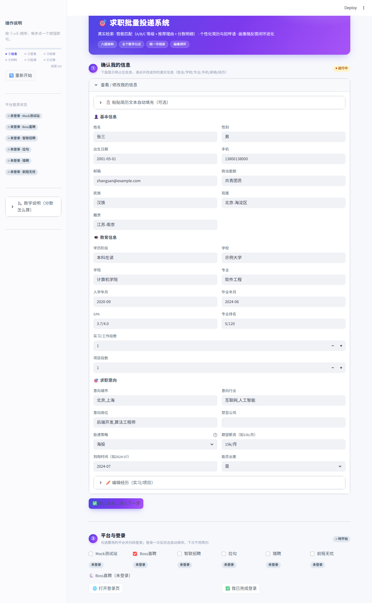
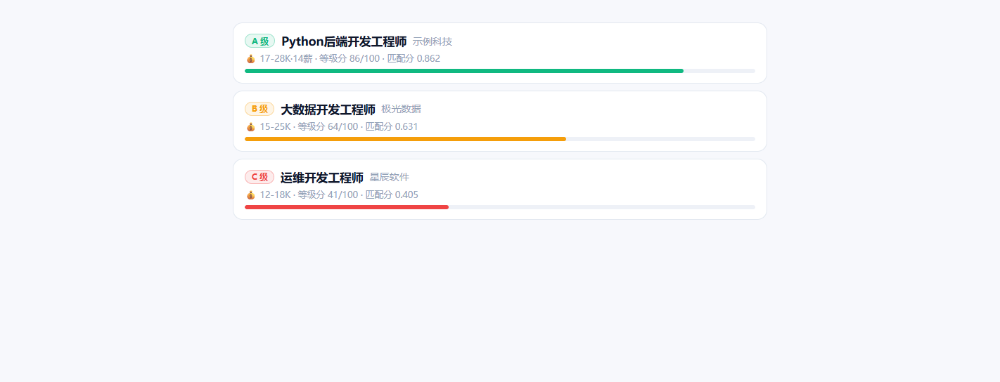
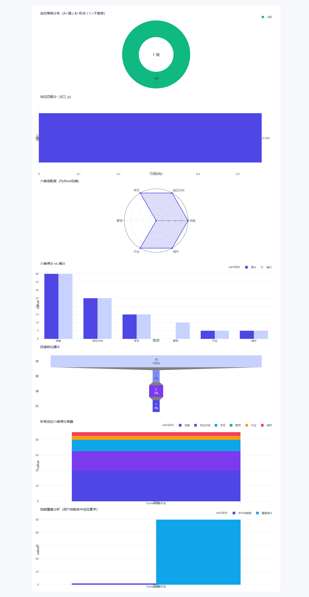
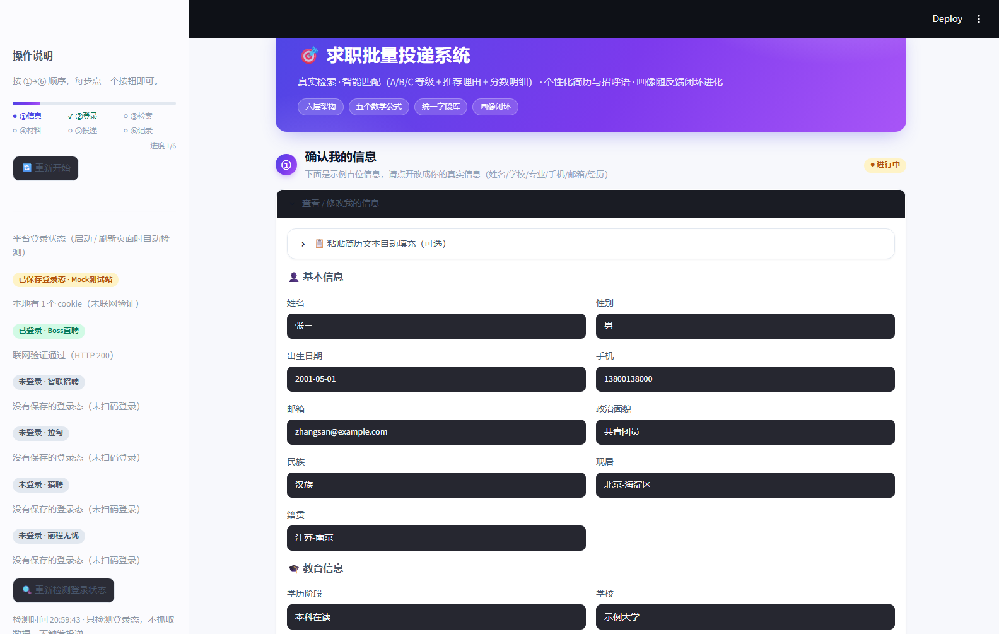
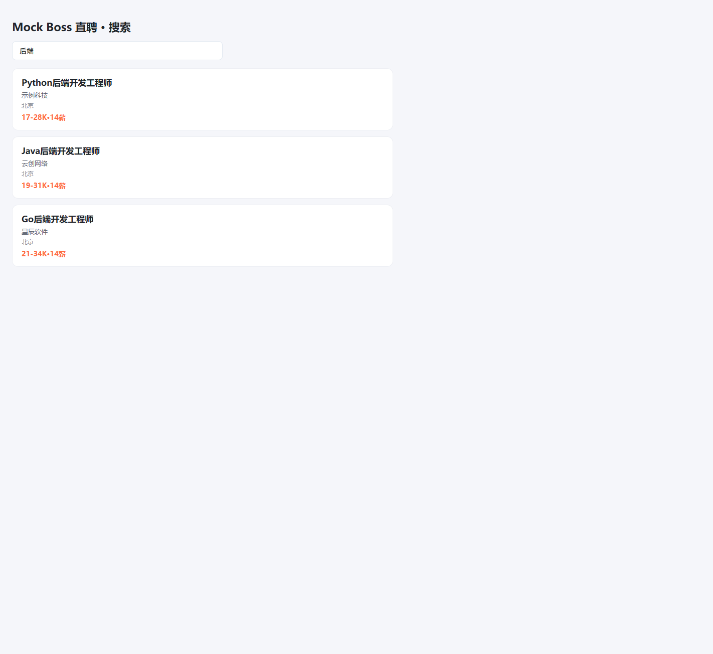
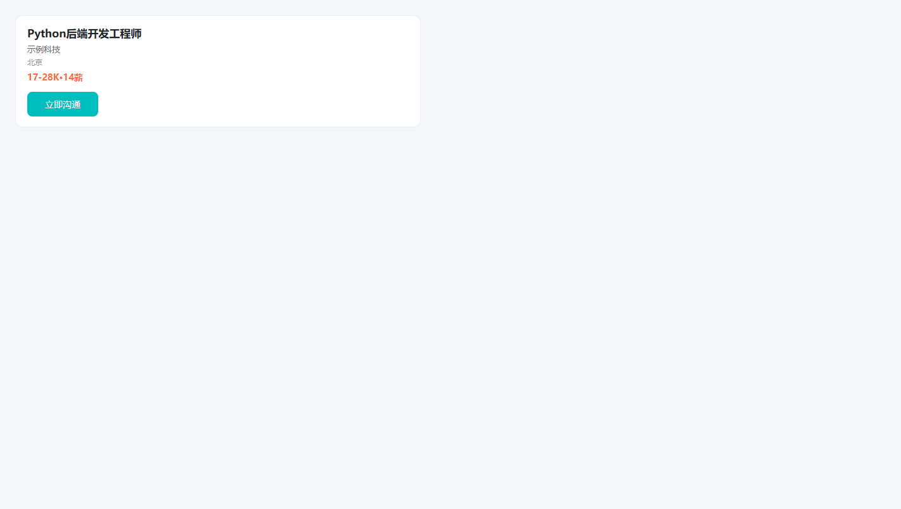

# 面向大学毕业生的求职批量投递系统

依据专利技术交底书《一种主要面向大学毕业生的求职批量投递系统及方法》实现的
**完整闭环求职批量投递系统**（系统软件设计 + 可运行产品）。

## 核心闭环

```
登录 → 检索 → 画像 → 匹配 → 建任务 → 生成简历 → 投递（手动确认）→ 反馈 → 权重修正 → 再画像
```

## 界面预览

| | |
|:---:|:---:|
| **Web Dashboard 主页**<br/> | **岗位推荐卡片**<br/> |
| **匹配分析与图表**<br/> | **平台登录态自动检测**<br/> |
| **Mock 站检索演示**<br/> | **Mock 岗位详情**<br/> |

> 以上界面均可离线复现：`python mock_e2e.py` 跑通全链路，`streamlit run app.py` 打开 Dashboard。

## ⚠️ 安全模式（重要）

系统**默认开启安全模式**（`config.SAFE_MODE = True`）：
- **检索、匹配、生成简历、生成招呼语**：正常自动执行；
- **投递/发消息**：能力在代码里（`delivery.deliver_one` + `session.dpage_deliver/dpage_greet`），
  但**默认只生成招呼语供你复制手动发送，绝不自动点「立即沟通」、绝不自动发消息给 HR**；
- 只有你明确把 `config.SAFE_MODE = False`，投递按钮才会真正自动执行。

> 自动投递会骚扰真实 HR、触发平台风控、有封号/法律风险，默认关闭。
>
> 侧栏「🔄 重新开始」旁边新增 **安全模式开关**（默认开）：关掉后投递才会真实发送，
> 侧栏会显示“⚠️ 安全模式已关闭”提示；该开关只影响当前运行进程，重启后回到 `config.SAFE_MODE` 的默认值。

### 批量投递（Boss 直聘「立即沟通」）

在第 ⑤ 步点击「🚀 批量投递」，或命令行 `python main.py batch [--limit N]`，即可**一口气按匹配分顺序投递多个岗位**。

安全护栏（即使关闭安全模式也强制生效，防止封号）：

| 护栏 | 值 | 说明 |
|---|---|---|
| 每日上限 | `DAILY_SEND_LIMIT = 20` | 单日最多投递条数，超限自动停止 |
| 单次批次 | `BATCH_SEND_LIMIT = 5` | 一次批量最多投几条（防短时间内高频） |
| 限速间隔 | `DELIVER_INTERVAL = 8` | 两条之间间隔秒数 |
| 风控熔断 | 自动 | 检测到验证码/登录失效/封号信号立即停止 |

> 所谓「一口气投无数个」在 Boss 直聘会直接触发 Code 32/36/37 封号。系统按保守参数分批+限速，
> 你可在 `config.py` 自行调大 `DAILY_SEND_LIMIT`/`BATCH_SEND_LIMIT`，但**风险自负**。

## 目录结构

| 文件 | 说明 |
|---|---|
| `设计文档.md` | 完整系统软件设计文档（架构/模块/数据库/算法/部署） |
| `config.py` | 全局配置（超参数、SMTP、安全模式、招呼语模板） |
| `schema.py` | 统一字段数据库字段定义（L0~L3、岗位、任务字段） |
| `db.py` | 存储层（SQLite 等价实现 MySQL） |
| `embedding.py` | 语义向量化（真实嵌入 / 离线哈希兜底） |
| `llm.py` | 受约束生成式 AI 客户端（字段限定 + 核对） |
| `crawler.py` | 岗位采集（字段别名映射 + 核对 + 登录态检索） |
| `platforms.py` | 招聘平台注册表（Boss/智联/拉勾/猎聘/51job + 城市码 + 接口字段映射） |
| `session.py` | 会话管理（DrissionPage 扫码登录 + 旁听接口 + 投递/打招呼） |
| `login_status.py` | 登录态检测（启动/刷新自动检测；本地判断 + 可选联网校验） |
| `formulas.py` | 五个核心公式（式一~式五） |
| `recommend.py` | 多维度匹配 + 匹配等级 + 推荐理由 + 画像摘要 + 个性化招呼语 |
| `persona.py` | 人物画像卡片数据（身份/技能/方向/偏好/一句话/能力匹配/条件契合） |
| `verification.py` / `user_profile.py` / `matching.py` / `tasks.py` | 步骤一~四 |
| `generation.py` / `delivery.py` / `feedback.py` | 步骤五~七 |
| `pipeline.py` / `loop.py` | 流程编排 |
| `app.py` | Web Dashboard（6 步向导） |
| `main.py` | CLI 入口 |
| `start.py` / `start.bat` | 一键启动 |

## 快速运行

需要 Python 3.10+（推荐 3.11–3.13）。Windows、macOS、Linux 使用同一套 Python 入口；本轮实际验证环境与未验证项见 `BUGFIX_REPORT.md`。

```powershell
cd "E:\work\deepseek_workspace\项目相关\job-delivery-system"
python setup_env.py --browser
python start.py
```

macOS/Linux 使用 `python3 setup_env.py --browser`，然后 `python3 start.py` 或 `sh start.sh`。Windows 也可双击 `start.bat`。`--browser` 安装登录/采集/表单依赖；仍需本机安装 Chrome、Edge 或 Chromium。仅使用本地匹配和材料生成时可省略 `--browser`。

独立智联采集器需要额外依赖：`python setup_env.py --crawler`；真实采集无本机浏览器时还需用项目虚拟环境执行 `python -m playwright install chromium`。`zhaopin_crawler/main.py --demo` 本身不需要 Playwright 浏览器。

复制到另一台机器时不要携带 `.venv`，在目标机器重新执行 `setup_env.py`。要保留业务记录，复制 `data/`、`resumes/`、`packages/`；浏览器登录请在新机器重新完成。旧数据库启动时自动添加字段和索引，不清空表。旧代码已经删除的岗位或无法关联到任务的历史样本不能凭空恢复。

常用启动命令：

```powershell
python start.py --check                 # 核心依赖诊断
python start.py --no-browser --port 0   # 自动选端口，打印访问地址
python start.py --foreground            # 前台运行，Ctrl+C 停止
```

默认端口 8501 被占用时自动选择空闲端口，请以控制台打印的地址为准。无 GUI 的服务器使用 `--no-browser`；自动化浏览器可通过 `JOBDELIVERY_HEADLESS=1` 运行。

配置环境变量后再启动（不会自动加载 `.env` 文件）：

| 变量 | 用途 |
|---|---|
| `JOBDELIVERY_HOME` | 可写的运行目录，存数据库、日志、简历、材料包、会话；默认项目目录 |
| `JOBDELIVERY_DB` | 可选的数据库文件完整路径 |
| `JOBDELIVERY_BROWSER` | 可选的 Chrome/Edge/Chromium 可执行文件完整路径 |
| `JOBDELIVERY_HEADLESS` | `1` 启用无界面浏览器，仅适合不需人工扫码的场景 |
| `JOBDELIVERY_SEARCH_HIDDEN` | `0` 关闭“检索静默”：默认检索不弹窗（复用登录浏览器；需新开时把窗口移到屏幕外并隐藏） |
| `JOBDELIVERY_LOGIN_CHECK` | `0` 关闭登录态联网校验（只做本地判断，完全离线） |
| `JOBDELIVERY_LOGIN_CHECK_TIMEOUT` | 登录态探测的 HTTP 超时秒数，默认 `6` |
| `SMTP_HOST` / `SMTP_PORT` / `SMTP_USER` / `SMTP_PASSWORD` | 邮件配置，默认 SSL 端口 465 |

安全模式下「查看投递材料」保持待投递；完成手动发送后再点「确认已手动投递」。HTTP 超时、浏览器提交未确认时进入「待核实」，核对平台记录后再确认，避免重复发送。

`requirements-tested.txt` 保存本轮 Windows/Python 3.13 干净环境的依赖快照，可用于复现该环境；跨平台安装优先使用 `requirements.txt`。

## 便携版（单文件 exe）

双击 `JobDeliverySystem.exe` 即用，**目标机器不需要安装 Python**：

```powershell
# 构建（需要 .NET 无要求；PyInstaller 会用到 pip）
pip install -r requirements-build.txt
build_portable.bat                  # 等价于：set PORTABLE_ONEFILE=1 && pyinstaller portable.spec
# 产物
dist\JobDeliverySystem.exe          # 单文件，约 139 MB
```

- 首次启动会把依赖解压到临时目录（约 10–15 秒），之后打开 <http://127.0.0.1:8501>；
- 打包内容包含 `app.py`、依赖、自定义组件 `components/match_space/`，并显式传入亮色主题基线与品牌主色；
- 运行数据（`data/`、`resumes/`、`packages/`、`sessions/`、`logs/`）默认写在 **exe 同目录**，整个文件夹可直接拷到 U 盘；目录不可写时回退 `%LOCALAPPDATA%\JobDeliverySystem`；
- 环境自检：`JobDeliverySystem.exe --check`（打印依赖版本与浏览器路径）；
- `--no-browser` 启动时不自动开浏览器；`JOBDELIVERY_PORT` 可指定端口（占用会自动换）；
- 真实平台登录/检索仍需要目标机器装有 Chrome / Edge（Windows 自带 Edge）；
- exe 未签名，Windows SmartScreen 可能提示“未知发布者”，选择“仍要运行”即可。

## 回归测试

一条命令执行全部核心回归（Windows 使用 `.venv\Scripts\python.exe`，macOS/Linux 使用 `.venv/bin/python`）：

```powershell
.venv\Scripts\python.exe run_checks.py
.venv\Scripts\python.exe verify_browser.py  # 可选：需要浏览器依赖及本机浏览器，只访问本地测试站
```

各测试使用独立临时数据库、会话目录和随机本地端口，避免修改真实数据。缺少可选 Selenium 时，核心回归会跳过对应表单测试；本机完整环境已执行该测试。

离线回归测试（不联网、不启动浏览器）：
```bash
python verify_formulas.py        # 式一~式五数学自洽性（凸组合/逻辑斯谛/指数倾斜/乘性更新/嵌入确定性）
python verify_resume_parse.py    # 简历解析（L0 全字段 + L2 经历/类型/量化成果）
python verify_rematch.py         # 画像闭环再匹配（式三间隔特征 δ 从冷启动 0 → 反馈后生效）
python verify_ui_compat.py       # 前端渲染兼容性（无 use_container_width 弃用告警）
python verify_viz.py             # 可视化数据源（六维分数明细/匹配分构成/权重演进结构）
python verify_health.py          # 代码健康度（schema/config/导入/不可达代码/核心表）
```

Mock Boss 全量端到端测试（本地 mock 站，真实走 HTTP 检索→投递→反馈，不碰真实 Boss）：
```bash
python mock_e2e.py               # 检索→画像→匹配→生成简历→投递→反馈→画像演进 全链路
```

### Mock 测试站（mock_site.py）

`python mock_site.py` 启动本地 mock 招聘站（127.0.0.1:5001），复现 Boss 直聘的**关键结构**，用于全量功能联调、逐个环节排查问题（无封号风险、不碰真实平台）：

| 复现环节 | URL / 选择器 |
|---|---|
| 搜索接口 | `/wapi/zpgeek/search/joblist.json` → `zpData.jobList` |
| 搜索页 | `/web/geek/job` → `li.job-card-wrapper` |
| 岗位详情 | `/job_detail/<id>.html` → `a.btn-startchat` |
| 聊天面板 | `.chat-input textarea` |
| 发招呼语 | `/wapi/zpgeek/friend/add.json`（POST） |
| 投递记录 | `/api/greets`（GET，供测试断言） |

> 只复现结构，不复现 Boss 的反爬/风控/限流性能（服务器私有、动态变化）。平台 `mock` 已注册在 `platforms.py`，可用 `crawler.search_via_requests("mock", ...)` 直接检索。

## 智能推荐与画像闭环（核心价值）

系统不只给岗位一个分数，而是提供**可解释的推荐体系**：

- **多维度匹配**：技能匹配（用户技术工具 vs 岗位技能标签）、岗位方向、学历、薪资、行业、城市六维分析；
- **匹配等级 A/B/C**：综合六维打分（技能40 + 方向25 + 学历15 + 薪资10 + 行业5 + 城市5），
  A=强匹配（≥60）、B=有机会（40~59）、C=不推荐（<40），硬约束不过不能强行高分；
- **推荐理由**：每个岗位附带「为什么推荐」（如"技能匹配：python、后端；学历符合要求；城市匹配：北京"）；
- **画像摘要**：从经历自动提取技能标签，形成画像全貌（专利步骤二第(5)点约束提示词的离线实现）；
- **个性化招呼语**：根据技能/方向匹配动态生成（命中技能则强调技能，比固定模板更针对）；
- **投递策略**：`海投`（默认，保留 A/B 级，自动去掉 C 级不推荐）/ `精投`（只保留 A 级强匹配）；
- **画像池**：每次投递反馈后保存画像快照（权重、正负中心），画像随投递行为持续优化，形成数据闭环；
- **重新匹配（闭环进化）**：标注进面试/未进面试后，点「🔄 用新画像重新匹配」，用式五修正的权重 + 正负岗位中心重新打分——式三间隔特征 δ=cos(j,c_+)-cos(j,c_-) 从冷启动的 0 变为有效值，匹配分随反馈进化（后端进面试后后端岗位分数升、前端岗位分数降）；
- **投递记录集中回写**：所有投递任务的状态与结果集中展示（专利要解决的问题三）。

### 简历解析（第①步自动填充）

粘贴简历文本或上传 PDF 后，系统离线规则解析并自动填充，减少手填：

- **L0 身份**：姓名（优先「姓名：XXX」）、性别、民族、政治面貌、现居、籍贯、出生日期、GPA、手机、邮箱、学校（优先「XX大学」，避免误把学院当学校）、学院、专业（「XX专业」或「专业：XX」）、入学/毕业年月、学历阶段（博士>硕士>本科>大专>专科>中专>高中，含在读/应届判定）；
- **L2 经历**：按时间范围「2023.06-2023.09」切分段落，含「项目/project」归为项目、否则实习/工作；提取技术工具、量化成果（「提升30%」「QPS 1000」）；
- **不误导**：解析出的经历自动填充卡片并清空示例占位数据；解析不到经历则留空由你手填；技能最终统一从 L2「技术工具」提取，保证画像口径一致。

### 数学可解释性（分数/权重都有解释）

- **分数明细**：等级分拆解为「技能40 + 方向25 + 学历15 + 薪资10 + 行业5 + 城市5」，每个岗位点开能看到每项得分；
- **匹配分解释**：侧边栏「📐 数学说明」给出式二/式三的公式含义（余弦相似度 + 间隔特征 → 逻辑斯谛）；
- **权重解释**：式一（凸组合）+ 式五（乘性更新）的数学含义，说明权重为什么随反馈变化；
- **简历检查**：每个岗位点开能看到生成的简历内容（字段表）+ 写入的经历（式四分配结果）；
- **画像演进可视化**：投递记录区用表格展示经历权重随反馈的演进（快照序列 + 正负中心是否形成）。

### 岗位匹配空间分析工作台（第 ⑤ 步）

第 ⑤ 步顶部是**分析工作台**：左侧三维匹配空间，右侧当前岗位详情，顶部一条精简人物画像摘要。
界面本体是 `components/match_space/` 下的轻量 Streamlit 组件（原生 HTML/CSS/SVG，无第三方前端依赖），
Python 侧由 `workbench.py` 组织真实数据并维护选中态：

- **人物画像摘要**：姓名、身份/方向、3–5 个核心技能；完整偏好与能力匹配收进「完整人物画像」折叠区；
- **三维匹配空间**：X=技能适配（技能得分/40）、Y=方向适配（方向得分/25）、Z=条件适配
  （学历+薪资+行业+城市）/35，各归一化到 0~100；越接近 100/100/100 参考角越匹配；
- **同坐标聚合**：三轴完全相同的岗位合并为一个点，点内数字 = 组内岗位数（保留原顺序）；
  点击点位选中该组，右侧可逐一切换组内岗位；
- **选中态**：普通点统一中性灰、选中点为靛蓝 + 外环 + 低透明度投影辅助线；点的位置和大小不再编码匹配分；
- **交互**：点击点位 / 右侧岗位列表 / 键盘可选的岗位下拉都能切换；拖动旋转、复位视角（只重置相机），
  页面重跑不丢当前选中与相机角度；
- **详情**：岗位名、单位、薪资、等级徽标、原始匹配分（3 位小数）、三项适配条、同坐标岗位列表；
  缺少六维分数的岗位显示“未知”，不会被当成 0 分；
- **亮/暗主题**：组件配色由 `theme.match_space_colors()` 传入，亮暗两套令牌见 `theme.MATCH_SPACE`；
- **全部岗位**：明细表收在「查看全部岗位」折叠区，不挤占主图。

> 原先的等级饼图、匹配分柱状图、六维雷达/堆叠柱状图、技能覆盖、转化漏斗、PCA 散点已从 ⑤ 撤下；
> `viz.py` 里的函数保留，第 ⑥ 步的「投递结果 / 经历权重」饼图仍在使用。

截图（合成数据、隔离页面）：

| 主题 | 文件 |
|---|---|
| 亮色 | `docs/match-space-light.png` |
| 暗色 | `docs/match-space-dark.png` |
| 窄屏 | `docs/match-space-narrow.png` |

### 数学可视化（第 ⑥ 步）

第 ⑥ 步保留与反馈闭环直接相关的两张图：

- **经历权重 α_k 饼图**：式一权重占比（随反馈变化）；
- **投递结果饼图**：进面试/未进面试分布（式五回写效果）。

## 6 步试用流程

1. **① 确认信息**：点开「查看/修改我的信息」，可**粘贴简历文本或上传 PDF 自动解析**填充，改成你的真实信息，点「✅ 确认信息」；刷新/重开后可用「📂 载入上次填写的信息」从本机数据库一键回填（仍需点确认）；
2. **② 平台与登录**：勾选 Boss直聘 → 点「🌐 打开登录页」→ 手机 Boss App 扫码 → 点「✅ 我已完成登录」；
3. **③ 检索岗位**：输入关键词（如 `Python 后端`）→ 点「🔍 开始检索」（真实检索，约 30~60 秒）；若按钮为灰，先把鼠标悬停看原因（①未确认 / ②无可用登录态 / 未勾选平台）；本地已有浏览器登录目录时按钮可用，检索若提示“登录态已失效”，回②重新扫码并点「✅ 我已完成登录」；
4. **④ 准备投递材料**：点「🚀 准备投递材料」→ 画像→匹配→生成简历 PDF + 个性化招呼语（投递策略海投/精投）；
5. **⑤ 逐条投递**：顶部是人物画像卡片 + 三维匹配空间（技能/方向/条件），每个岗位显示等级+推荐理由+分数明细+匹配分计算过程+招呼语+简历检查（点开看）。安全模式默认开启，不会自动发消息；
6. **⑥ 投递记录**：集中展示投递状态、进面试统计、画像演进（经历权重随反馈变化），可导出 CSV。

## 登录与检索（真实平台反爬的正确做法）

参考开源项目 eatmoreduck/boss-zhipin-scraper、boss_batch_push、Ocyss/boss-helper：

1. **登录**：DrissionPage 打开登录页（持久化隔离 profile），扫码一次即可；
2. **登录态保持**：登录浏览器**保持打开不退出**（Boss 登录 cookie 是会话级，浏览器一关就失效），
   检索时复用这个浏览器；登录态失效时，回到第②步重新扫码即可；
3. **检索**：用 DrissionPage 的 `listen` 旁听浏览器自己发的搜索接口响应（浏览器 JS 自动带反爬 token），
   从接口 JSON 拿明文 `jobName / brandName(行业) / cityName / salaryDesc / jobDegree(学历) / jobExperience(经验) / contact(已沟通)`；
4. **滚动翻页**：模拟滚动触发无限滚动，收集所有接口响应并去重；
5. **已沟通过滤**：跳过 `contact=true` 的岗位，避免重复投递。

## 六层架构 ↔ 模块映射

| 架构层级 | 模块 |
|---|---|
| ① 用户输入层 | `app.py` + `verification.py` |
| ② 模型层1-用户画像 | `user_profile.py`（式一，避免遮蔽标准库 profile） |
| ③ 操作层1-信息匹配 | `matching.py`（式二、式三） |
| ④ 操作层2-建立任务 | `tasks.py` |
| ⑤ 模型层2-任务执行 | `generation.py`（式四 + PDF 简历） |
| ⑥ 结果输出层 | `delivery.py` + `feedback.py`（式五） |

## 接入真实服务（生产化）

- **嵌入**：`config.EMBED_MODEL` 设为 `sentence-transformers` 模型名。
- **生成式 AI**：`ConstrainedLLM(api_key=..., base_url=..., model=...)` 传入即启用真实 LLM 短任务生成。
- **数据库**：`db.py` 切换 MySQL 只需替换连接层，表结构一致。
- **招呼语**：`config.GREETING_TEMPLATE` 可自定义（占位符 {姓名}{学校}{专业}{岗位}）。

> 免责声明：真实平台检索/投递请遵守目标平台 robots.txt 与用户协议，
> 仅用于学习研究，不要恶意爬取、商业转售或无人值守批量投递。


